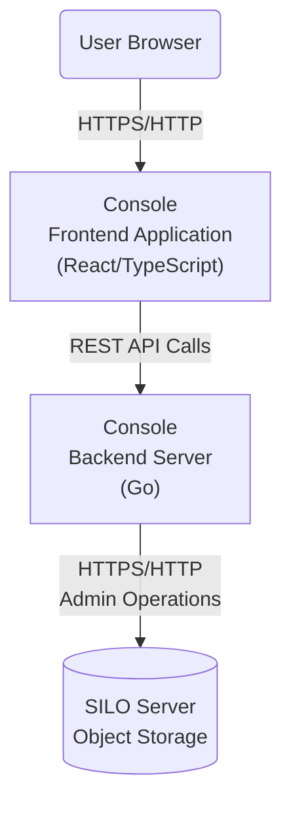

# Developing Console

SILO Console is maintained and release-tested with the coordinated `pgsty/silo`,
`pgsty/silo-console`, `pgsty/mc` and `pgsty/silo-pkg` stack. Use a SILO server for
local integration testing. Compatibility with unmodified upstream MinIO is best
effort and advisory; it must not force a downgrade of a maintained component.
The verified upstream `github.com/minio/minio-go/v7` SDK remains the explicit
external dependency exception.

For local development, run the Go Console API and its frontend together:



> [!IMPORTANT]
> MinIO is a registered trademark of MinIO, Inc. SILO Console is independent
> and is not affiliated with or endorsed by MinIO, Inc.

## Running the Console server

Use the Go version declared in `go.mod`. From the repository root:

```sh
make console
```

Start the server against your SILO endpoint, substituting your own values:

```sh
export CONSOLE_MINIO_SERVER='<silo-endpoint>'
export CONSOLE_DEV_MODE=on
./console server --host 127.0.0.1 --port 9090
```

Sign in using an account on that SILO deployment. Development mode is for local
frontend work; use the ordinary server configuration for standalone acceptance.
See [docs/Environment.md](docs/Environment.md) for endpoint, region and TLS
settings.

## Running the Console frontend

Use the Node.js version in [`.nvmrc`](.nvmrc) and Yarn selected by
[`web-app/package.json`](web-app/package.json):

```sh
cd web-app
yarn install --immutable
yarn start
```

Vite serves <http://localhost:5005> and proxies API calls to the local Console.
MDS is a private source workspace at `web-app/packages/mds`, compiled with the
application. Edit its source directly, preserve upstream notices and document
local modifications in `UPSTREAM.md`; there is no separate MDS package build.
The [frontend guide](web-app/README.md) covers shared UI primitives, navigation,
translations, bundle budgets, checks and the opt-in GUI regression runner.

For a standalone embedded preview, run `make assets` at the repository root and
then `make console`. Generated assets belong in a separate reviewed commit after
source, tests and documentation are final. A local build does not publish or
deploy a release. See [docs/Embedding.md](docs/Embedding.md) for the maintained
module graph and downstream replacement requirements.

# Best-effort compatibility testing inside upstream MinIO

To test Console embedded in an upstream-compatible MinIO binary, build it from
the MinIO repository as described below. This is an advisory compatibility
workflow, not the supported SILO release workflow, and its result must not
override the maintained `silo-pkg` dependency selected for SILO.

### 0. Building with UI Changes

If you are performing changes in the UI components of console and want to test inside the MinIO binary, you need to
build assets first.

In the console folder run

```shell
make assets
```

This regenerates the static assets served by the compatible object-storage binary.

### 1. Clone the `MinIO` repository

In the parent folder of where you cloned this `console` repository, clone the MinIO Repository

```shell
git clone https://github.com/minio/minio.git
```

### 2. Update `go.mod` to use your local version

In the MinIO repository open `go.mod` and after the first `require()` directive add a `replace()` directive

```
...
)

replace (
github.com/minio/console => "../console"
)

require (
...
```

### 3. Build `MinIO`

Still in the MinIO folder, run

```shell
make build
```

# Testing with a Container

If you want to test Console in a container, follow the steps from
`Compatibility testing inside MinIO`, but change `Step 3`
to the following:

```shell
TAG=miniodev/console:dev make docker
```

This will build a docker container image that can be used to test with.

You can use it in your local kubernetes environment aswell.

For example, if you are using kind:

```shell
kind load docker-image miniodev/console:dev
```

and then deploy any `Tenant` that uses this image
